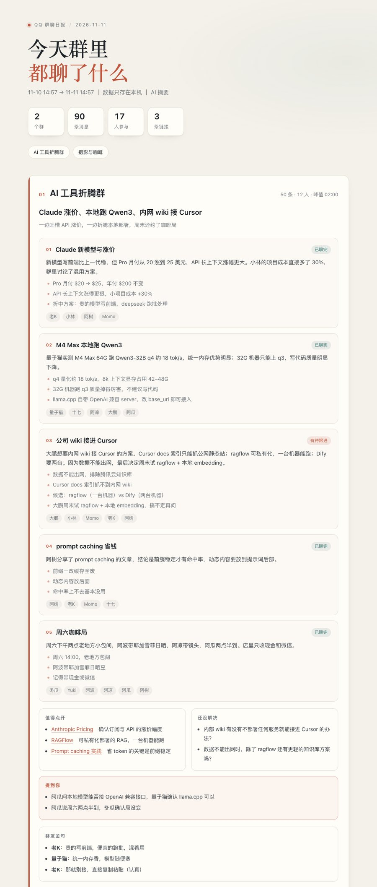

# qq-digest · QQ 群聊日报

> 🐧 **AI 学习群：1132348296**（在 QQ 里搜群号就能加）— 群聊日报怎么做、QQ 机器人怎么接，群里都有人踩过坑。

## 三大亮点

1. **一条命令出日报** —— 把群里 24 小时的聊天整理成一页中文日报：每个群的话题、谁在说、什么值得点开、什么还没解决。
2. **顺手挖机会** —— 除了「聊了什么」，还从对话里提炼可做的 AI 产品/插件线索，附需求、形态和原话依据。
3. **本地优先、有兜底** —— 消息只进本机 SQLite；模型 key 没配也能用规则摘要出日报，模型挂了照样有产出。

---

把关注的 QQ 群最近聊了什么，整理成一页能读的中文日报：每个群有哪些话题、谁在说、什么值得点开、什么还没解决、哪句提到了你。



- **本地优先**：消息存在本机 SQLite，不经过任何第三方服务器。
- **两个 AI 路径**：配了模型 key 就一条命令跑完；没有 key 就让当前 AI 读素材、写摘要、再渲染。
- **机会雷达**：除了“聊了什么”，还从对话里提炼可做的 AI 产品/插件线索（需求、可做的形态、原话依据、信号强弱）。
- **有降级**：模型挂了会退回规则摘要，日报照样能出。
- **零依赖**：只用 Python 3.9+ 标准库。

## 安装

**作为 DSH 插件（推荐）**——一条命令装进 DeepSeek Harness，技能名仍是 `qq-digest`：

```bash
dsh plugin add github:clair0314/dsh-qq-radar
```

插件自带 Python CLI，本机需要 Python 3.9+（无第三方依赖）。装好后直接对 agent 说“总结一下群里今天聊了什么”。

**从源码**：

```bash
git clone https://github.com/clair0314/dsh-qq-radar.git
cd dsh-qq-radar
./bin/qq-digest init          # 生成 ~/.qq-digest/config.json
open examples/demo.html       # 先看看成品长什么样
```

接上 QQ 之后再：

```bash
./bin/qq-digest check                     # 测试 OneBot、列出群
./bin/qq-digest digest --since 24h --open # 拉消息 + 总结 + 打开日报
```

### 推送到飞书（手机直接看）

群里加一个「自定义机器人」，把 Webhook 填进 `~/.qq-digest/config.json` 的 `push.feishu_webhook`（开了签名校验再填 `push.feishu_secret`），然后：

```bash
./bin/qq-digest push --summary /tmp/qq/summary.json --bundle /tmp/qq/bundle.json --dry-run  # 先预览
./bin/qq-digest push --summary /tmp/qq/summary.json --bundle /tmp/qq/bundle.json            # 真发
```

卡片里是时间窗口、每群 headline + 3 条话题、机会雷达。完整版（含群聊原声）仍是本机的 `reports/latest.html`。

### 1. 接入 QQ（OneBot 11）

用的是 **OneBot 11 协议 + 本机登录的 QQ 小号**（NapCat / Lagrange）。官方机器人只能收实时消息、还得拉进每个群，读不了历史，所以不适合做日报。

> ⚠️ 第三方 QQ 客户端有账号风控风险，请务必使用小号。

Mac 上最省事的是 NapCat 的 Docker 镜像：

```yaml
# compose.yaml
services:
  napcat:
    image: mlikiowa/napcat-docker:latest
    restart: unless-stopped
    environment:
      MODE: ws
      WEBUI_TOKEN: 换成一个自己的口令
    ports:
      - "127.0.0.1:6099:6099"
      - "127.0.0.1:3000:3000"
    volumes:
      - ./data/qq:/app/.config/QQ
      - ./data/config:/app/napcat/config
```

```bash
docker compose up -d
```

打开 `http://127.0.0.1:6099/webui` 扫码登录，在「网络配置」里新增 **HTTP 服务器**（端口 `3000`，token 自定），再把 token 填进 `~/.qq-digest/config.json` 的 `onebot.token`。

也可以选跨平台的 [Lagrange.OneBot](https://github.com/LagrangeDev/Lagrange.Core)，开 HTTP 实现即可。

### 2. 配置

```json
{
  "onebot": {"base_url": "http://127.0.0.1:3000", "token": "你的 token"},
  "groups": [{"id": "123456789", "name": "AI 工具折腾群"}],
  "me": {"names": ["阿瓜"], "qq": "1008611"},
  "llm": {"api_key": "sk-...", "model": "deepseek-chat"}
}
```

- `groups` 留空 = 机器人所在的全部群；`exclude_ids` 排除不想看的群。
- `me.names` 用来在日报里标出「提到你」。
- 不填 `llm.api_key` 也能用，见下面「三种用法」。

## 三种用法

### A. 全自动（需要模型 API key）

```bash
./bin/qq-digest digest --since 24h --open
```

拉消息 → 按群调模型 → 写 `reports/日期.html`、`.md`、`.json` 和 `latest.html`。单群失败会自动降级，不影响其他群。

### B. 让当前 AI 代写（不需要 key）

```bash
# 1. 导出素材，顺便把每个群拆成单独 txt
./bin/qq-digest bundle --collect --since 24h --out /tmp/qq/bundle.json --split /tmp/qq/parts

# 2. 把 /tmp/qq/parts/*.txt 交给 AI，让它按 SKILL.md 里的契约写 /tmp/qq/summary.json

# 3. 用现成摘要渲染
./bin/qq-digest render --summary /tmp/qq/summary.json --bundle /tmp/qq/bundle.json --open
```

在 DeepSeek Harness 里直接说“总结一下群里今天聊了什么”，`qq-digest` 技能会自动走这条路。

### C. 不联网的规则摘要

```bash
./bin/qq-digest digest --since 24h --no-llm --open
```

按时间分段、按信息量挑句子，标题和要点会朴素一些，但完全离线。

## 命令

| 命令 | 作用 |
| --- | --- |
| `init` | 生成配置文件 |
| `check` | 测试 OneBot 连接、列出群 |
| `groups` | 只列群 |
| `collect` | 只拉消息入库（可反复跑，自动去重） |
| `bundle` | 导出给模型看的素材；`--split DIR` 按群拆 txt |
| `digest` | 拉取 + 总结 + 日报；`--no-llm` 离线 |
| `render` | 用现成 summary JSON 渲染 |
| `prune` | 清理旧消息和旧日报 |

时间窗口 `--since` 支持 `24h`、`3d`、`90m`、`today`、`yesterday`、`week` 或 ISO 时间。

退出码：`0` 成功，`2` 配置问题，`3` OneBot 连不上，`4` 模型调用失败。

## 日报里有什么

- 每个群一句 `headline` + 一句群氛围，下面是 3–6 个话题卡：标题、两三句概括、要点、参与的人、状态（已聊完 / 有待跟进 / 还在聊）。
- 「值得点开」收集群里发的链接，「还没解决」收集悬而未决的问题。
- 「提到你」标出与你有关、可能需要回应的消息。
- 「群友金句」挑一两句原话。
- 「展开群聊原声」可以看当天原始记录（被抽样的会注明）。
- 自动生成 `reports/index.html` 归档页，支持深色模式和打印。

## 数据与隐私

- 消息库：`~/.qq-digest/messages.db`（SQLite，WAL）。
- 日报：`~/.qq-digest/reports/`。
- 配置：`~/.qq-digest/config.json`，权限 `0600`。
- 只有路径 A 会把群聊文本发给模型；路径 B 的文本只进入当前会话；路径 C 完全不联网。
- `messages.db` 和 `config.json` 不要提交到 git。

## 开发

```bash
# 跑测试（假 OneBot + 假模型，不联网）
PYTHONPYCACHEPREFIX=/tmp/qqdigest-pyc PYTHONDONTWRITEBYTECODE=1 python3 tests/test_e2e.py

# 重新生成示例日报
PYTHONPYCACHEPREFIX=/tmp/qqdigest-pyc PYTHONDONTWRITEBYTECODE=1 python3 tests/make_demo.py
```

```
app/qqdigest/
  cli.py        命令行
  onebot.py     OneBot 11 HTTP 客户端
  normalize.py  消息段 / CQ 码 → 纯文本
  store.py      SQLite 去重存储
  collect.py    分页拉历史
  bundle.py     按预算裁剪素材
  llm.py        OpenAI 兼容客户端
  summarize.py  提示词 + 校验 + 降级
  report.py     HTML / Markdown 渲染
```

要求 Python 3.9+，无第三方依赖（测试和示例图用到了 Pillow，仅开发时需要）。

## 常见问题

**为什么不用官方 QQ 机器人？** 官方全量群消息只推实时事件，需要机器人进每个群，也没有历史回补，做不了“过去 24 小时”的日报。

**会被封号吗？** 第三方登录有风险，用小号、别频繁操作。工具只读消息，不发消息。

**能总结私聊吗？** 目前只做群聊；`collect` 的分页逻辑对私聊同样适用，可以自己扩展。

**消息太多会超上下文吗？** `bundle` 会按 `llm.max_input_chars` 分配预算，折叠表情/图片，优先保留链接和长消息，并标注省略了多少条。
